<!-- ============ HEADER ============ -->

  
  
  
  

  
  
  
  

---

## ⚡ About Me

> *"Clean data doesn't guarantee right answers — domain logic, sound modeling, and rigorous validation do."*

I build **production-oriented AI systems** that people can actually trust: RAG assistants that **cite their sources**, vector search engines that retrieve what matters, NLP classifiers with **calibrated confidence**, and Power BI dashboards that executives actually read.

| | |
| :-- | :-- |
| 🔭 **What I build** | RAG compliance assistants • FAISS / Qdrant vector search • Multi-class NLP classifiers • Executive Power BI dashboards |
| 🎓 **Education** | PG Program in **Data Science, Analytics & GenAI** (*Imarticus Learning*) • **B.Com** (*MGKVP*) |
| 🏅 **Credentials** | **IBM Certified** — Advanced AI/ML & Machine Learning with Python |
| ✍️ **Writing** | [Your Data Looks Clean. So Why Is Your Dashboard Wrong?](https://medium.com/@gauravvsingh1122/your-data-looks-clean-so-why-is-your-dashboard-wrong-c3729ab5387d) |
| 🎯 **Looking for** | **Data Scientist** • **Data Analyst** • **AI/ML Engineer** roles |

---

## 🧰 Technical Arsenal

| Layer | Stack |
| :--- | :--- |
| **Languages & Databases** |    |
| **Analytics & BI** |       |
| **ML & Deep Learning** |    |
| **GenAI, NLP & Vector Search** |      |
| **Deployment & Tooling** |       |

---

## 🧠 How I Think About Building AI

```mermaid
flowchart LR
    A[📥 Raw Data<br/>Scraped • APIs • Text] --> B[🧹 Clean & Validate<br/>Domain logic first]
    B --> C[🧬 Represent<br/>TF-IDF • Embeddings]
    C --> D[🔎 Retrieve / Model<br/>FAISS • Qdrant • ML]
    D --> E[🛡️ Guardrails<br/>Calibration • Citations]
    E --> F[📊 Deliver<br/>Streamlit • Power BI]

    style A fill:#0F172A,stroke:#38BDF8,color:#F8FAFC
    style B fill:#0F172A,stroke:#38BDF8,color:#F8FAFC
    style C fill:#0F172A,stroke:#38BDF8,color:#F8FAFC
    style D fill:#0369A1,stroke:#38BDF8,color:#F8FAFC
    style E fill:#0369A1,stroke:#38BDF8,color:#F8FAFC
    style F fill:#0F172A,stroke:#38BDF8,color:#F8FAFC
```

**Principles I build by:** 🔍 *grounded over guessed* • 📏 *validate before you trust* • 🧭 *domain logic beats model complexity* • 🚀 *ship something people can use*

---

## 🏗️ Flagship Projects

<table>
  <tr>
    <td width="50%" valign="top">
      <h3>🏦 BharatBank RBI — Compliance RAG</h3>
      
Enterprise RAG assistant that indexes <b>RBI Master Directions</b> using automated web scraping, <b>hybrid vector retrieval</b>, and <b>grounded citation synthesis</b> — so every answer points back to the regulation it came from.

      

        
        
        
        
        
      

      <a href="https://github.com/Gaurav-Singh-09/BharatBankRBI"><b>🔗 View Repository →</b></a>
    </td>
    <td width="50%" valign="top">
      <h3>🌍 Global Intelligence News Classifier</h3>
      
Multi-class NLP routing console that categorizes live news streams across intelligence domains, with <b>calibrated confidence guards</b> and full <b>probability distributions</b> for transparent decisions.

      

        
        
        
        
        
      

      <a href="https://github.com/Gaurav-Singh-09"><b>🔗 View Repository →</b></a>
    </td>
  </tr>
  <tr>
    <td width="50%" valign="top">
      <h3>🎬 CineVerse — Vector Movie Recommender</h3>
      
Content-based discovery engine powered by <b>FAISS similarity indexing</b> and live <b>TMDB</b> metadata, wrapped in a sleek dark-mode interface.

      

        
        
        
        
        
      

      <a href="https://github.com/Gaurav-Singh-09/cineverse"><b>🔗 View Repository →</b></a>
    </td>
    <td width="50%" valign="top">
      <h3>🕵️ Fraudulent Job Posting Detector</h3>
      
Supervised NLP pipeline and real-time Streamlit app that flags <b>deceptive job listings</b> directly from unstructured recruitment text.

      

        
        
        
        
      

      <a href="https://github.com/Gaurav-Singh-09/fraud_detection_app"><b>🔗 View Repository →</b></a>
    </td>
  </tr>
  <tr>
    <td width="50%" valign="top">
      <h3>🛰️ Global Space Agencies Dashboard</h3>
      
Executive <b>Power BI</b> suite tracking launch cadence, mission success rates, and payload performance across global space programs.

      

        
        
        
        
      

      <a href="https://github.com/Gaurav-Singh-09"><b>🔗 View Repository →</b></a>
    </td>
    <td width="50%" valign="top">
      <h3>✍️ Article: Silent BI & Data Traps</h3>
      
<i>"Your Data Looks Clean. So Why Is Your Dashboard Wrong?"</i> — a breakdown of aggregation edge cases and business-logic bugs hiding behind clean datasets.

      

        
        
        
        
      

      <a href="https://medium.com/@gauravvsingh1122/your-data-looks-clean-so-why-is-your-dashboard-wrong-c3729ab5387d"><b>📖 Read on Medium →</b></a>
    </td>
  </tr>
</table>

---

## 🌱 Currently

- 🔨 Sharpening **RAG evaluation** — retrieval quality, citation faithfulness, hallucination checks
- 📚 Exploring **hybrid search & reranking** for domain-specific document sets
- 📊 Pairing **ML outputs with BI storytelling** so models translate into business decisions

<b>💡 Fun facts & what I'm like to work with</b>

 

- I distrust a dashboard until I've traced every number back to the source.
- I'd rather ship a smaller system that's *verifiably correct* than a bigger one that merely *looks* smart.
- I write about the failures too — the silent bugs teach more than the wins.

---

## 📊 GitHub Analytics

 

  

---

## 🤝 Let's Connect

**Have a data problem, an AI idea, or an opening on your team? Let's talk.**

